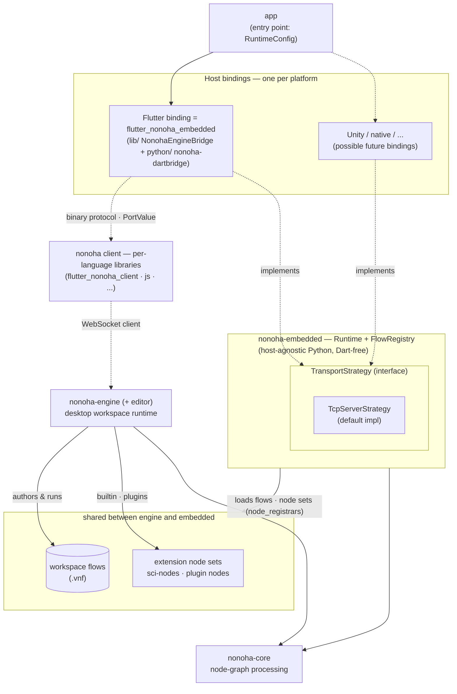
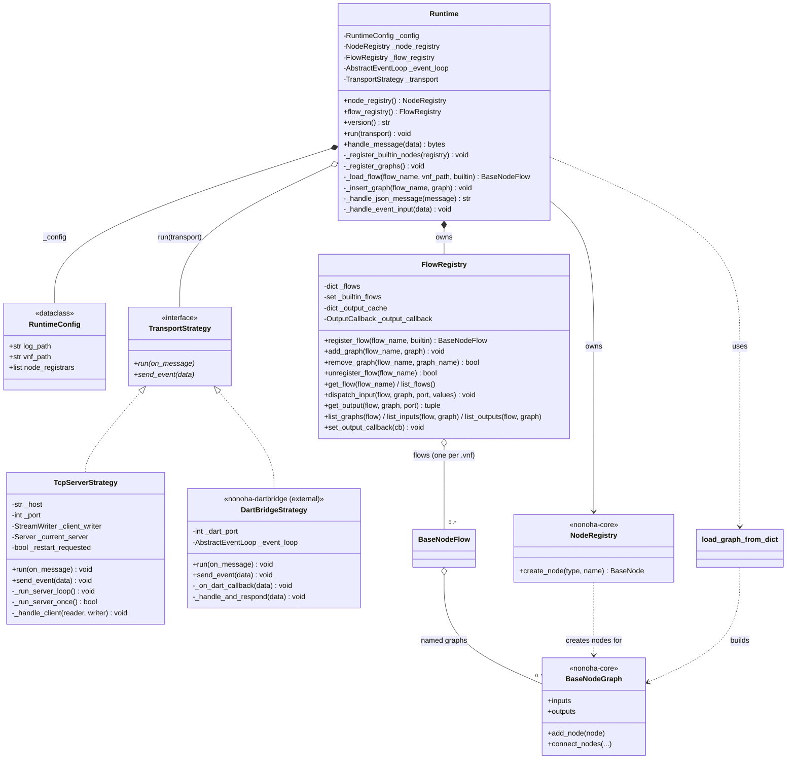
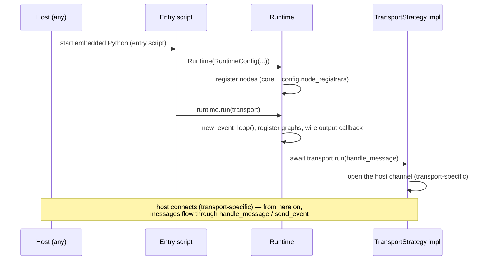
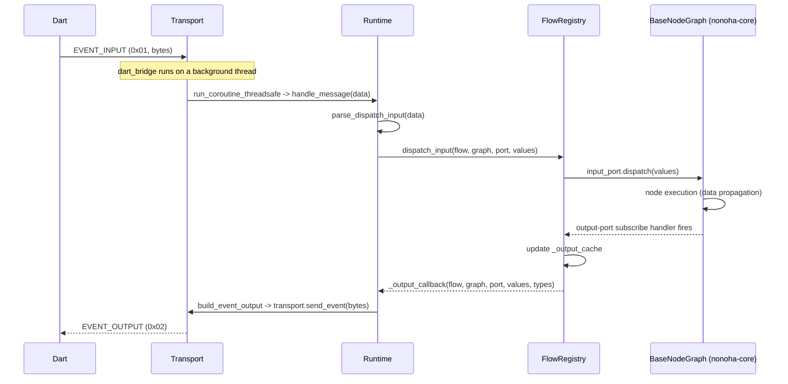

# nonoha-embedded Architecture

`nonoha-embedded` is a **host-agnostic** embedding runtime that runs nonoha's
node-graph processing (`nonoha-core`) **as in-process Python inside an app**. It
does not depend on Flutter — or on any particular host / UI framework. A *host
layer* (the upper layer) drives it over a transport; `flutter_nonoha_embedded`
is the current reference host binding and is used as the example throughout this
document, but other hosts (e.g. a Unity binding) could sit on top in the future.
It provides four things:

- **Runtime** — owns node registration, graph registration, message handling, and the event loop.
- **Transport** — a pluggable strategy for the host channel (dart_bridge FFI for Flutter, or host-agnostic TCP).
- **FlowRegistry** — flows (named graph collections, one per `.vnf`), input dispatch, output retrieval, and output subscription. Graph names are scoped per flow; a flow is also the GraphProxy resolution scope.
- **Message protocol** — binary / JSON encoding and decoding of port values.

This is what keeps it host-agnostic: `nonoha-embedded` contains **no Dart code
and no dart_bridge dependency**. The Dart/Flutter-specific `DartBridgeStrategy`
lives in the Flutter binding as a separate package (`nonoha-dartbridge`, under
flutter_nonoha_embedded/python), not here. A non-Dart host (e.g. Unity) drives
the exact same `Runtime` over `TcpServerStrategy` (or its own transport) with
nothing Dart-specific involved.

## Position in the ecosystem

`nonoha-embedded` is the lower, host-agnostic layer. On top sits a **host
binding** (one per platform) and, above it, the **app** whose entry point
constructs `RuntimeConfig`. A binding provides its own `TransportStrategy`
implementation (or reuses the shipped `TcpServerStrategy`);
`flutter_nonoha_embedded` is the reference binding. Bindings lean weakly on
per-language **nonoha client** libraries (e.g. `flutter_nonoha_client`, js)
for `PortValue` types and the port-value binary layout — the same libraries
that serve as WebSocket clients for `nonoha-engine`.

`nonoha-engine` — the desktop workspace runtime — is a peer consumer of
`nonoha-core`. The **workspace** is the shared artifact: flows (`.vnf`)
authored on the engine load unchanged here. Extension node sets (sci-nodes,
plugin nodes) all expose the same `register_nodes(registry)` convention; the
engine has sci-nodes builtin and loads plugins dynamically, while here the
app bundles them and injects via `node_registrars`.

## Module layout

| Module | Key elements | Responsibility |
| --- | --- | --- |
| `runtime.py` | `Runtime` / `RuntimeConfig` / `TransportStrategy` | Core: node & graph registration, message routing, event loop |
| `flow_registry.py` | `FlowRegistry` / `OutputCallback` | Flows of graphs, graph I/O, output cache, push subscription |
| `graph_loader.py` | `load_graph_from_dict()` | Builds a `BaseNodeGraph` from a JSON dict |
| `message_protocol.py` | `parse_dispatch_input()` / `build_event_output()` etc. | Binary / JSON message encode & decode |
| `transports/tcp_server_strategy.py` | `TcpServerStrategy` | Host-agnostic TCP transport (auto-restart for iOS backgrounding) |
| `testing.py` | `test_nonoha_core()` / `test_scipy()` | On-device self-tests |

> The dart_bridge FFI transport (`DartBridgeStrategy`) is **not** in this core.
> It ships in the Flutter host binding as the `nonoha-dartbridge` package
> (flutter_nonoha_embedded/python), which imports the `dart_bridge` FFI module.

## Class diagram

`NodeRegistry`, `BaseNodeGraph`, `PortValue`, `PortValueType`, and `DataType`
are external classes from `nonoha-core` (the `packages/nonoha-core` submodule).
`load_graph_from_dict` is a module-level function in `graph_loader.py`.

## Key classes

### `Runtime` (`runtime.py`)

The heart of the embedding runtime. **It does not depend on dart_bridge.**
`__init__` initializes in this order:

1. **Logging** — attaches a stdout handler to the root logger (plus a `FileHandler` when `log_path` is set).
2. **NodeRegistry** — `_register_builtin_nodes()` calls `nonoha_core.nodes.register_nodes()` (which includes GraphProxy/GraphLoaded/GraphPropertiesChanged), then invokes each `RuntimeConfig.node_registrars` callable. Extension packages (e.g. `sci_nodes.register_nodes`) are injected by the app entry point — this runtime knows no specific extension names.
3. **FlowRegistry** — created empty.

`run(transport)` creates an explicit event loop via `asyncio.new_event_loop()`
(not `asyncio.run()`), then `_run_async()` registers graphs, wires the output
callback, and awaits `transport.run(self.handle_message)`.

`handle_message(data)` dispatches on the first byte (the message type):

- `0x00 JSON` → `_handle_json_message()` (`ping` / `version` / `test_*` / `list_flows` / `load_flow` / `unload_flow` / `list_graphs` / `list_graph_inputs` / `list_graph_outputs` / `get_output`). Graph-scoped operations address graphs as `(flow_name, graph_name)`; flows are the only unit of loading.
- `0x01 EVENT_INPUT` → `_handle_event_input()` dispatches to an input port (fire-and-forget, no response).

### `RuntimeConfig` (dataclass)

Holds `log_path: str | None` (log destination), `node_registrars` (extension
node-set injection), and `vnf_path` (a `.vnf` workspace flow folder) —
every graph in its `flow.json` loads into a builtin flow named after the
folder stem.

### `TransportStrategy` (Protocol)

The **Strategy-pattern** interface that abstracts the communication channel:

- `async run(on_message)` — the receive loop; takes `on_message(bytes) -> bytes | None` and returns a response when there is one.
- `send_event(data)` — pushes an output event to the client.

`Runtime` knows nothing about concrete implementations; it depends only on the
`transport` passed to `run()`.

### `TcpServerStrategy` (`transports/tcp_server_strategy.py`)

A TCP transport listening on `127.0.0.1:8765` (default). Because **iOS can
invalidate the socket when the app is backgrounded**, `_run_server_loop()`
detects `OSError` and auto-restarts the server (with heartbeat logging). The
frame is `[4-byte length][payload]`. It has no special dependencies, so it is
re-exported from `transports/__init__.py`.

### `DartBridgeStrategy` (external — Flutter binding's `nonoha-dartbridge`)

> This class is **not part of this core**. It lives in the Flutter host binding
> as the `nonoha-dartbridge` package (flutter_nonoha_embedded/python). It is
> documented here because it is the reference transport used by the example, and
> it implements this core's `TransportStrategy` protocol.

An in-process transport over the `dart_bridge` FFI (bundled by
serious_python inside the app). Because it does `import dart_bridge`, it runs
**only inside the embedded app**. Two key points:

- **Port via environment variable** — the host creates the channel and hands its port number over in an environment variable before the interpreter starts; the strategy reads it and calls `dart_bridge.set_enqueue_handler_func(port, handler)`. There is no in-band handshake — the host's send simply fails (and is retried) until the handler is registered. Details live in the binding's own documentation.
- **Thread boundary** — `_on_dart_callback` is invoked on dart_bridge's background thread, so it hands work to the event loop via `asyncio.run_coroutine_threadsafe()`.

### `FlowRegistry` (`flow_registry.py`)

Manages flows (`nonoha_core.node.BaseNodeFlow` instances, one per `.vnf`)
and mediates graph I/O. Mutations are flow-centric:

- `register_flow(flow_name, builtin=False)` — creates an empty flow (registry-owned instance).
- `add_graph(flow_name, graph)` — inserts a graph into its flow (setting `parent_flow`, the GraphProxy resolution handle) and subscribes to every output port; each emission is cached in `_output_cache` and fires `_output_callback` (turning it into a push event).
- `remove_graph(flow_name, graph_name)` — unsubscribes from the outputs, then the flow finalizes the graph (releasing node-owned resources such as running clock timers) — the same teardown pattern as the engine.
- `unregister_flow(flow_name)` — removes a whole flow, finalizing all its graphs (also the rollback path for a failed `load_flow`).
- `dispatch_input(flow, graph, port, values)` / `get_output(flow, graph, port)` — graph I/O.
- `list_flows()` (topology) / `list_graphs(flow)` / `list_inputs(flow, graph)` / `list_outputs(flow, graph)` — metadata.

Policy (builtin immutability, reserved `_`-prefixed names) is enforced by
the Runtime message handlers, keeping the registry mechanical so internal
paths like rollback can always clean up.

### `graph_loader.load_graph_from_dict(name, data, registry)`

Builds a `BaseNodeGraph` from a dict compatible with nonoha-engine's
`graph.json`. The steps are: create nodes and apply properties / dispatch_flags
→ create graph input ports → create graph output ports → connect edges. An edge
endpoint is either `"Node.port"` (a node) or `".port"` (graph I/O), and the
loader connects them accordingly.

## Message protocol (`message_protocol.py`)

The first byte is the message type:

| Type | Value | Direction | Contents |
| --- | --- | --- | --- |
| `MSG_TYPE_JSON` | `0x00` | both ways | JSON control message (UTF-8 JSON from byte 2 on) |
| `MSG_TYPE_EVENT_INPUT` | `0x01` | Client→Server | fire-and-forget dispatch to an input port |
| `MSG_TYPE_EVENT_OUTPUT` | `0x02` | Server→Client | push event from an output port |
| `MSG_TYPE_GET_OUTPUT_RESPONSE` | `0x03` | Server→Client | binary response for `get_output` |

- **Binary input** (`0x01`): `[type][flow_len][flow][graph_len][graph][event_type][port_len][port][value_count]{[data_type][ndim][shape...][data_size][data]}...`. `parse_dispatch_input()` reconstructs arrays zero-copy with `np.frombuffer` (big-endian).
- **Binary output** (`0x02` / `0x03`): `0x02` carries `[flow][graph][port]` headers; port values are serialized by reusing `nonoha-core`'s `port_values_to_bytes()`.
- **JSON messages** (`0x00`): `ping`→`pong`, `version`, `test_nonoha_core` / `test_scipy`, `list_flows`, `load_flow`, `unload_flow`, `list_graphs`, `list_graph_inputs`, `list_graph_outputs`, `get_output`. `get_output` always answers binary (`0x03`).

## Sequence: startup (transport-agnostic)

The core's startup contract is the same for every transport; how the host
*connects* is transport-specific and documented with each transport/binding
(e.g. the Flutter binding's docs for `DartBridgeStrategy`; for
`TcpServerStrategy` a host simply connects to `127.0.0.1:8765`).

## Sequence: data flow (input dispatch -> output push)

For `get_output` (pull), Dart sends a `0x00 JSON` `get_output`; `Runtime`
returns the value cached in `FlowRegistry.get_output()` as a `0x03` binary
response.

## Threading model

- `Runtime.run()` explicitly creates a **single event loop** with `asyncio.new_event_loop()` and blocks on `run_until_complete()` (it never uses `asyncio.run()`).
- **The dart_bridge callback (`_on_dart_callback`) runs on a background thread separate from the event loop.** To start work on the loop from there it uses `asyncio.run_coroutine_threadsafe(coro, self._event_loop)`. Never touch asyncio objects directly from a non-loop thread.
- The TCP transport is built on `asyncio.start_server`; receive, drain, heartbeat, and restart are all tasks on that same loop.

## Design notes

- **Host-agnostic core** — the runtime has no Flutter/Dart dependency and ships no dart_bridge code. `flutter_nonoha_embedded` is an upper *host layer* (the reference binding); any other host (e.g. Unity, a native app) can embed the same `Runtime` by speaking the message protocol over a transport.
- **Pluggable transport (Strategy)** — `Runtime` depends only on `TransportStrategy`. The core ships the host-agnostic `TcpServerStrategy` as its default implementation (non-Flutter hosts, standalone development); host-specific transports are provided by the host binding — the Flutter binding provides `DartBridgeStrategy` via `nonoha-dartbridge`.
- **Host-specific transport lives with its binding** — `DartBridgeStrategy` imports the app-injected `dart_bridge` FFI module, so it ships in the Flutter binding's `nonoha-dartbridge` package (flutter_nonoha_embedded/python), keeping this core Dart-free. A future host co-locates its own transport with its binding the same way.
- **scipy-free core + injected extension nodes** — `nonoha-core` is numpy-only (scipy-free). Extension node sets (e.g. the scipy-dependent `sci-nodes`) are injected by the app entry point via `RuntimeConfig.node_registrars`; the runtime hardcodes no extension package names (dependency direction stays app → runtime).
- **Flow-scoped graphs** — a flow (one per `.vnf`) is the graph namespace, the GraphProxy resolution scope, and the only unit of loading. Graph names are unique per flow only, so multiple installed flows may reuse names like `main`.
- **iOS backgrounding** — `TcpServerStrategy` detects socket invalidation (`OSError`) and auto-restarts (relevant to hosts that use the TCP transport on iOS).
- **Zero-copy I/O** — input is reconstructed with `np.frombuffer`; output serialization reuses `nonoha-core`'s `port_values_to_bytes`.

## Related

- Upstream (Dart): [flutter_nonoha_embedded](https://github.com/viestyle-dev/flutter_nonoha_embedded) / [flutter_nonoha_client](https://github.com/viestyle-dev/flutter_nonoha_client)
- Dependencies: [nonoha-core](https://github.com/viestyle-dev/nonoha-core) (the `packages/nonoha-core` submodule)
- Extension node sets (app-injected via `node_registrars`, e.g.): [sci-nodes](https://github.com/viestyle-dev/sci-nodes)
